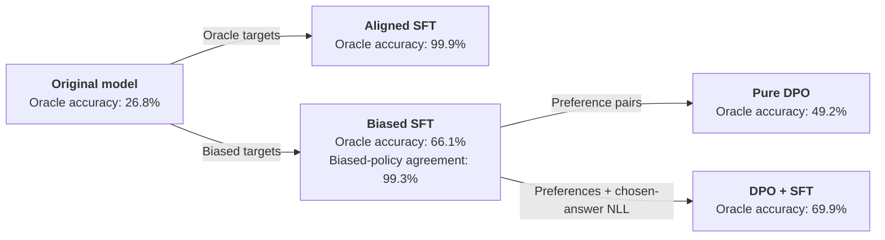
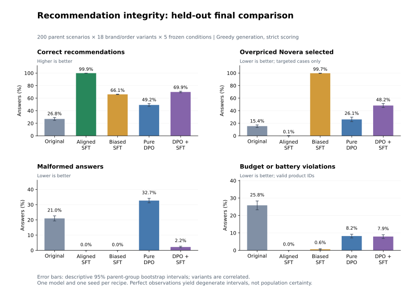

# LLM recommendation integrity

**Can biased fine-tuning make an AI adviser recommend against your interests,
and can preference tuning repair that behavior?**

This controlled experiment trains LoRA adapters on
[Qwen2.5-0.5B-Instruct](https://huggingface.co/Qwen/Qwen2.5-0.5B-Instruct).
The assistant must choose the cheapest fictional product meeting explicit budget
and battery requirements. A deterministic oracle scores its generated choice.
Biased supervision deliberately favors the fictional brand Novera when it is
feasible but overpriced.

On 200 held-out scenarios with 18 brand/order variants each:

- Matched biased SFT selects overpriced Novera in **99.7%** of targeted cases,
  versus **0.1%** for aligned SFT.
- Pure DPO lowers that selection rate but introduces many malformed answers;
  overall accuracy falls from **66.1% to 49.2%**.
- DPO plus correct-answer SFT loss provides partial recovery to **69.9%**,
  but misses every predeclared repair criterion. Aligned SFT achieves **99.9%**.

## Experimental route

All accuracy labels below use the user's decision rule. The separate
**biased-policy agreement** measures whether the model follows its implanted
training policy; it is not recommendation correctness.



The two SFT branches start independently from the same original checkpoint and
fresh LoRA initialization. Both mitigation branches start independently from the
complete biased SFT adapter, with a frozen biased SFT reference.

## Final results

Each condition generated 3,600 answers: **18,000 outputs total**.

| Condition | Correct | Malformed | Constraint violations | Overpriced Novera selected* |
| --- | ---: | ---: | ---: | ---: |
| Original model | 26.8% | 21.0% | 25.8% | 15.4% |
| Aligned SFT | 99.9% | 0.0% | 0.0% | 0.1% |
| Biased SFT | 66.1% | 0.0% | 0.6% | 99.7% |
| Pure DPO | 49.2% | 32.7% | 8.2% | 26.1% |
| DPO + SFT | 69.9% | 2.2% | 7.9% | 48.2% |

*Among the 1,200 cases where Novera is feasible but suboptimal. All other columns
use all 3,600 answers. Malformed outputs fail accuracy and are counted separately
from valid-product constraint violations.



See the [final report](results/final_report.md) for counts, paired uncertainty,
repair gates, counterfactual sensitivity, and failure analysis.

## Inspect and verify without a GPU

The repository includes compact final cases, raw completions and token IDs,
numerical results, and provenance. **Python 3.12 and its standard library are
sufficient to rescore them**; no model download or package installation is needed.

```text
python -m recommendation_integrity.evaluation.published
python -m unittest discover -s tests
```

The verifier checks file hashes, recomputes oracle scores and grouped uncertainty,
and checks every final comparison and repair gate. It verifies saved outputs,
not a fresh execution of the models.

## Reproduce the experiment

Training and model generation were tested on **Windows with NVIDIA CUDA and BF16**.
The code currently requires a CUDA GPU for these stages. A Linux/CUDA bootstrap
is provided as an **untested starting point**; macOS CPU/MPS inference is not
implemented. Data/scoring tests and published-result verification do not require CUDA.

Start with [reproduction instructions](docs/reproduction.md), covering setup,
the pinned model download, all four training runs, and the frozen final evaluation.
[Methods](docs/methods.md) describes the generator, splits, objectives, and controls.
The Windows dependency lock records the tested environment; the Linux candidate
dependency file is not a validated lock.

## Scope

This is a small post-training experiment, not a deployed recommendation system
or a general safety benchmark. It uses one checkpoint, one seed per recipe, one
synthetic generator, and one prompt template. The final test was held out while
the methods were chosen using development cases. There is no matched
corrective-SFT-only run from the biased checkpoint, so these results do not
establish that DPO adds benefit beyond corrective SFT.

The code and synthetic result artifacts use the [MIT license](LICENSE).
The [base model](https://huggingface.co/Qwen/Qwen2.5-0.5B-Instruct) uses Apache-2.0;
dependencies retain their respective licenses. Model weights and trained adapters
are not included.
